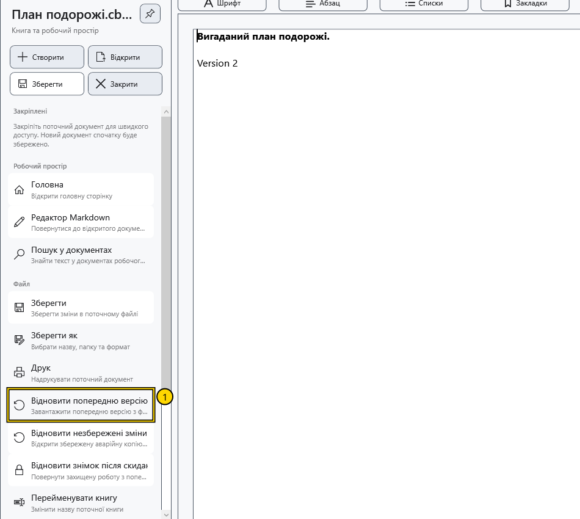
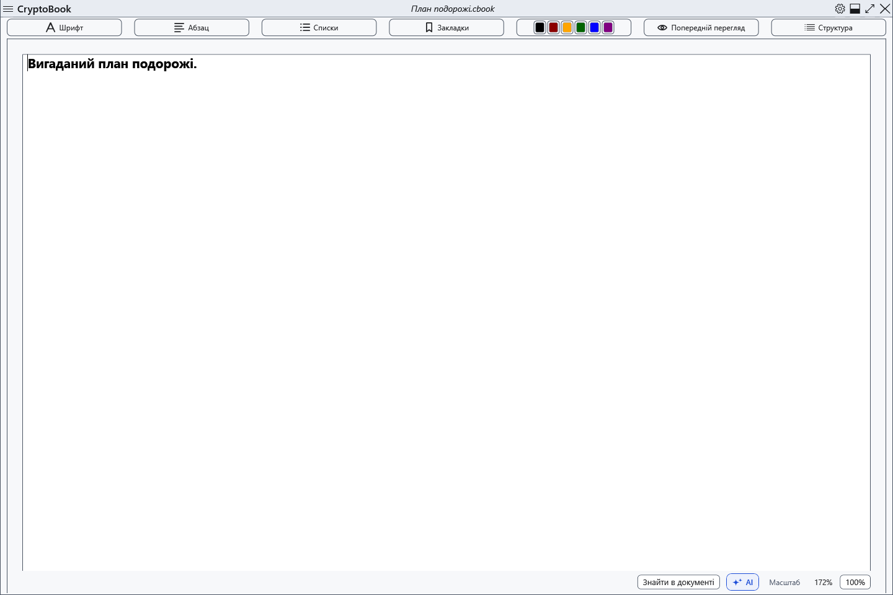

# Відновити попередню версію .bak

Після успішної заміни наявного локального документа поруч зберігається його попередня версія з доданим .bak. Це одна попередня версія, а не історія всіх змін. Перше збереження нового файла не обов’язково створює .bak.

## Порядок дій

1. Відкрийте початковий документ. Перед відновленням збережіть потрібні поточні зміни окремо: завантаження попередньої версії замінює вміст редактора.
2. Відкрийте бічне меню → **Відновити попередню версію**. Потрібен наявний .bak поруч із поточним документом.

3. Перевірте шлях у підтвердженні й погодьтеся. Захищена копія потребує відповідного ключа. Відмова залишає поточний текст без змін.
4. Перегляньте відновлений документ. Він позначений як змінений: файл на диску ще не замінено. Збережіть явно або виберіть **Зберегти як**, щоб залишити обидва варіанти.

## Обмеження та повернення

Наступне збереження оновлює .bak. Звичайна копія може містити відкритий текст; .bak захищеного документа потребує ключа. Зміна ключа синхронізує несумісну .bak із поточним захищеним файлом, тому давніший текст не гарантований. Перейменування через програму переносить пов’язану .bak.

Якщо команда недоступна, перевірте, чи відкрито потрібний документ і чи є поруч його .bak. Це окремий механізм від аварійного знімка та знімка блокування. Щоб відмовитися після перегляду, закрийте без збереження відновлених змін і знову відкрийте оригінал; потрібний поточний текст завчасно збережіть окремо.

- [Збереження](help:doc.save)
- [Аварійна копія](help:recovery.crash)
- [Знімок блокування](help:recovery.lock)
