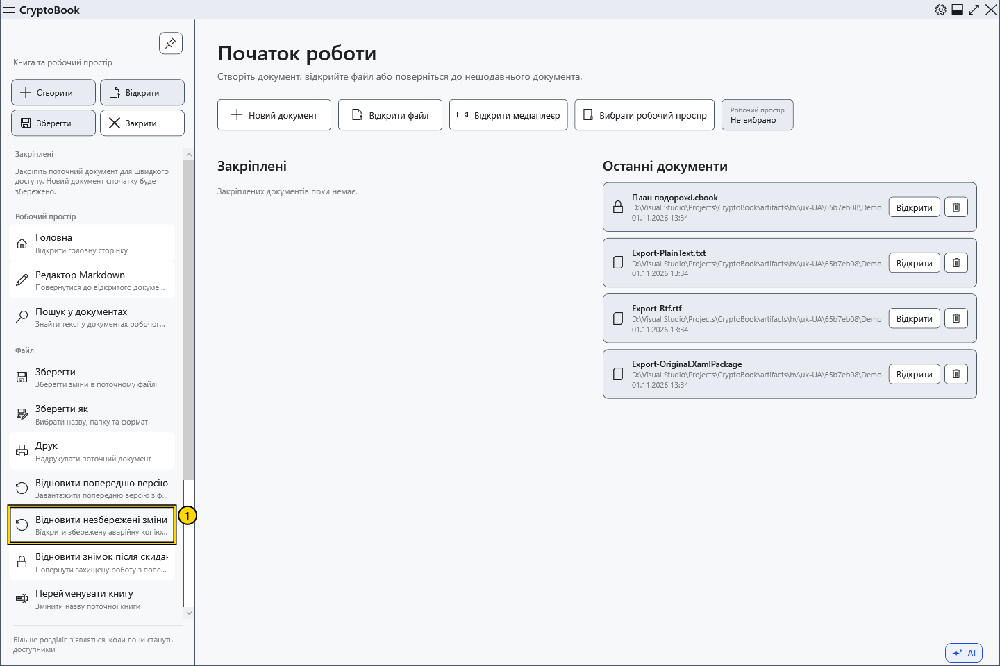
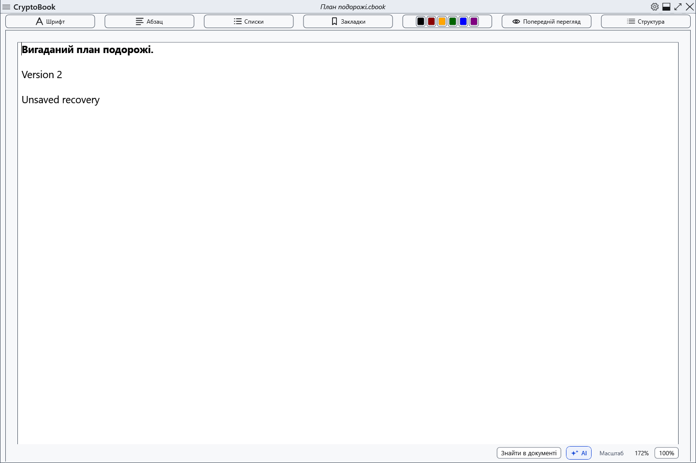

# Аварійний знімок незбережених змін

CryptoBook періодично зберігає окремий знімок зміненого робочого простору. Він допомагає після неочікуваного завершення, але не замінює збереження: останні дії могли ще не потрапити до копії. Звичайне очікування після змін — близько 15 секунд.

## Відновити збережену копію

1. Збережені аварійні копії зберігаються окремо від нової роботи. Програма запускається без сповіщень про відновлення.
2. Відкрийте бічне меню → **Файл** → **Відновити незбережені зміни**. Без збереженої копії команда недоступна. За наявності кількох копій повертається остання за часом збереження; старіші залишаються для наступного відновлення.
3. Якщо поточні документи змінені, спочатку виберіть збереження, відмову від змін чи скасування. Для захищеного знімка потрібен ключ CryptoBook, використаний при створенні, а не пароль Windows.

4. Перевірте повернутий вміст і збережіть явно. Він відкривається як змінений; якщо документів два, перевірте обидва. Перед видаленням використаної відкладеної копії програма записує нову аварійну копію повернутої роботи.

## Скасування та помилки

Можна продовжувати роботу без відкриття відновлення. Скасування введення ключа чи рішення щодо поточного документа зберігає копію. При неправильному паролі або помилці доступу перевірте початковий ключ і повторіть спробу; не видаляйте файли відновлення.

Старі аварійні копії можуть використовувати колишній захист обліковим записом Windows, зокрема для раніше захищеної роботи. Новий пароль не змінює вже створених копій; вимога ключа CryptoBook стосується нового формату захищених знімків.

Знімки розміщено в даних користувача окремо від .bak і Lock. Звичайні знімки захищені засобами поточного облікового запису Windows, захищені документи — паролем CryptoBook. Перенесення звичайного знімка іншому користувачеві Windows не гарантує читання. Штатне закриття видаляє поточний аварійний знімок; раніше відкладені копії залишаються. Це не резервування на іншому носії.

- [Знімок блокування](help:recovery.lock)
- [Помилки запису](help:recovery.write)
- [Два редактори](help:doc.switch)
