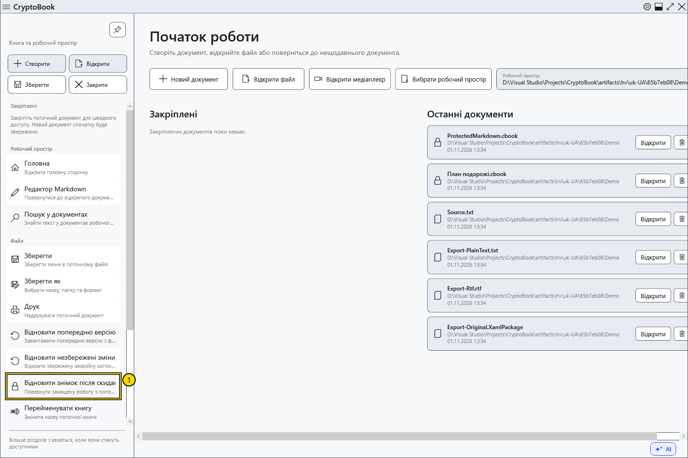
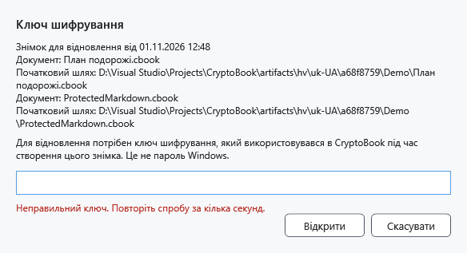
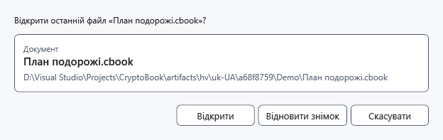

# Відновити знімок після скидання ключа

Знімок блокування створюється під час скидання ключа для захищеної роботи. Він зберігається окремо від .bak та аварійної копії, не перезаписує звичайний оригінал і потребує колишнього ключа CryptoBook.

## Порядок дій

1. Відкрийте бічне меню → **Файл** → **Відновити знімок після скидання ключа**. Сповіщення під час запуску та після успішного скидання не з’являються. Без знімка команда недоступна. Для прихованої після помилки роботи скористайтеся **Розблокувати** й не закривайте програму.

2. Перевірте опис документа й уведіть ключ на час створення знімка. Є одне приховане поле без повтору. **Відкрити** перевіряє ключ до доступу до вмісту. Неправильний ключ не видаляє знімок; перед повтором зачекайте кілька секунд.

3. Після перевірки виберіть **Відкрити** для збереженого початкового файла або **Відновити знімок** для незбереженого вмісту знімка. Якщо оригінал недоступний, залишається знімок. За наявності двох захищених документів перевірте обидва. Відкриття оригіналу бере його збережену версію, а не останні зміни активного документа.

## Результат і скасування

Після успіху знімок видаляється. Відновлений зі знімка вміст позначений як змінений і потребує збереження. Скасування введення/вибору не видаляє знімок. Скасування вибору після перевірки залишає ключ у пам’яті — за потреби скиньте його ще раз.

Якщо запис знімка не вдався, приховану роботу можна повернути лише в ще запущеному процесі з колишнім ключем. Універсального обходу забутого пароля немає.

- [Скидання ключа](help:security.lock)
- [Аварійна копія](help:recovery.crash)
- [Попередня версія](help:recovery.backup)
