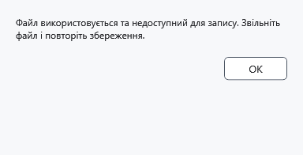

# Помилки запису та безпечне продовження

Помилка означає, що збереження не завершене. Поки документ позначений як змінений, не закривайте програму й не видаляйте оригінали або копії відновлення.

## Що робити

1. Прочитайте повідомлення. Якщо файл зайнятий, закрийте програму, яка його утримує, та повторіть **Зберегти**. При відмові доступу виберіть доступну папку через **Зберегти як**; якщо бракує місця, звільніть його чи виберіть інший диск.
2. Для захищеної роботи збережіть захищений формат і відповідний ключ. Скасування вибору призначення чи попередження залишає зміни незбереженими. Звичайний формат може відкрити вміст для читання.

3. Після успіху перевірте, що позначка змін зникла, а шлях очікуваний. Якщо сумніваєтеся, відкрийте збережену копію та порівняйте текст і оформлення.

## Що залишається

Локальне збереження спочатку готує результат, потім замінює призначення; при перевіреній відмові через зайнятий файл початкові байти зберігаються, а текст залишається в редакторі. Це не гарантія при відмові накопичувача, втраті живлення чи для будь-якої дії на пристрої. .bak містить попередню успішну версію, аварійний знімок — незбережену роботу, lock-знімок — захищену роботу під час скидання ключа. Жоден не означає успішного збереження оригіналу.

Скасування перебігу — запит зупинки: дочекайтеся завершення й перевірте результат. Пакет може виконатися частково; загального Undo для запису/шифрування немає. При помилці lock-знімка перед закриттям процесу розблокуйте приховану роботу колишнім ключем. Для MTP окремо перевірте підключення, дозволи й результат на пристрої.

- [Збереження](help:doc.save)
- [Попередня версія](help:recovery.backup)
- [Аварійна копія](help:recovery.crash)
- [Знімок блокування](help:recovery.lock)
