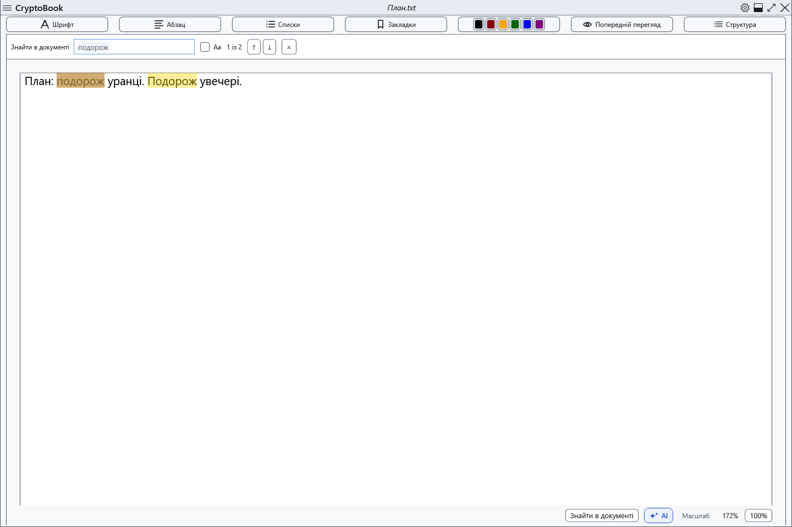
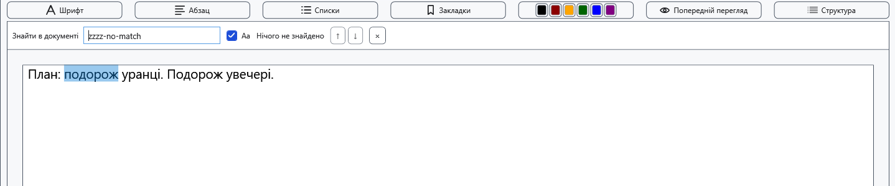
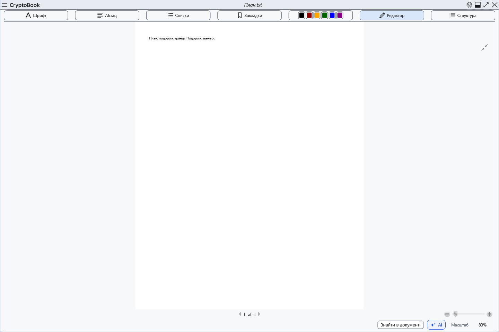
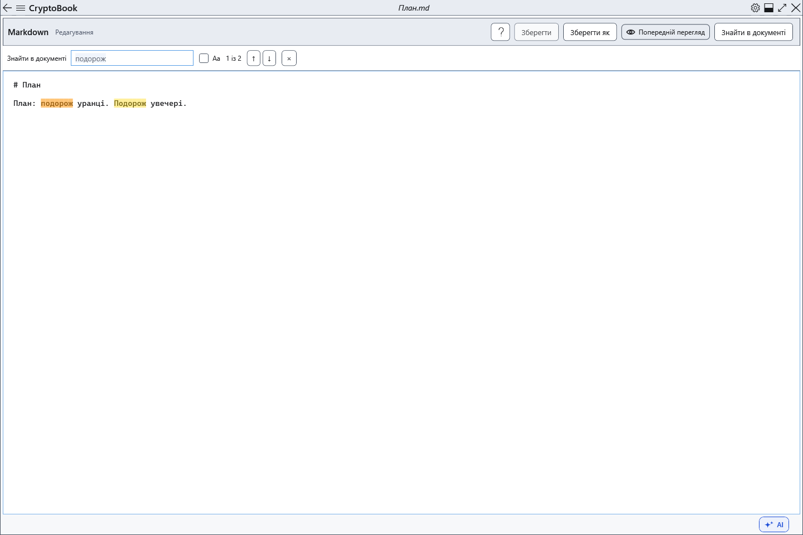
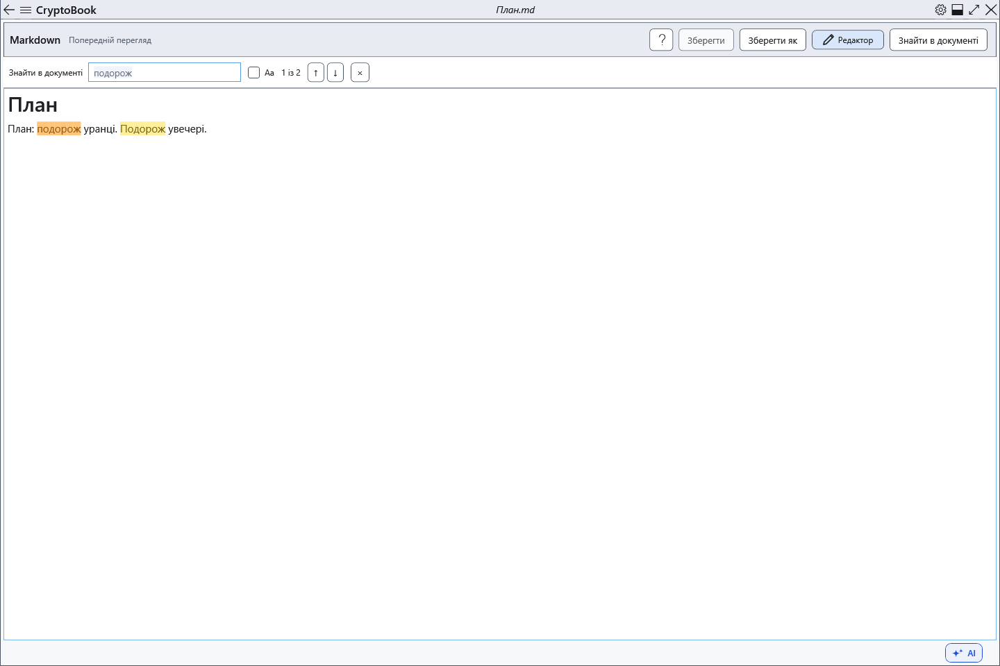

# Пошук у поточному документі

Пошук підсвічує збіги в поточному документі й показує номер результату.

## Перед початком

Відкрийте потрібний документ і активуйте його сторінку. Джерело Markdown містить розмітку, а перегляд — відображений текст, тому збіги можуть відрізнятися.

У звичайному документі посторінковий перегляд закриває пошук. Кнопка пошуку або Ctrl+F із цього перегляду повертає до редагування й шукає там. Обидва режими Markdown підтримують пошук.

## Порядок дій

1. Натисніть **Знайти в документі** або Ctrl+F, коли фокус в області документа. Введіть текст; після короткої паузи з’являться підсвічування й лічильник.
2. Прапорець **Aa** (**Враховувати регістр**) вмикає врахування регістру.
3. Кнопки ↑/↓ вибирають попередній/наступний збіг. У полі запиту працюють Enter і Shift+Enter; за відкритої панелі в області документа — F3 і Shift+F3. Після останнього збігу перехід повертається до першого.
4. Натисніть × (**Закрити пошук (Esc)**) або Esc в області документа для закриття панелі.

## Перевірка результату

Поточний збіг виділено та прокручено у видиму область. Пошук буквальний, без заміни, масок і розпізнавання тексту на зображеннях. Зміна тексту оновлює результати.

## Скасування й повернення

Закриття прибирає пошукове підсвічування та повертає фокус у редактор. Текст і внесені правки зберігаються.

## Якщо не вдалося

Якщо збігів немає, перевірте Aa й режим Markdown. Enter поза полем запиту не є пошуковою командою. Ctrl+F у довідці шукає в довідці; в інших вікнах дія залежить від фокуса.

## Пов’язані теми

- [Перегляд, сторінки й масштаб](help:edit.view)
- [Редагування Markdown](help:md.edit)
