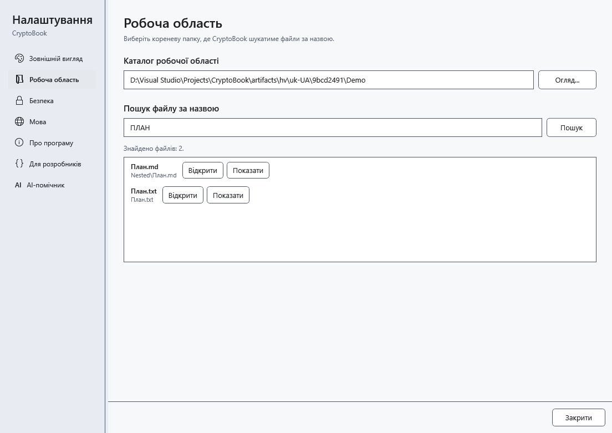

# Пошук файлів за назвою

Пошук за назвою знаходить файли у вибраній робочій папці та її підпапках. Його область відрізняється від фільтра поточної папки файлового менеджера та пошуку вмісту документів.

## Перед початком

Спочатку виберіть локальну робочу папку. Підключений Android не входить до області цього пошуку.

## Порядок дій

1. Відкрийте налаштування й розділ **Робоча область**. Перевірте шлях робочої папки.
2. У полі **Пошук файлу за назвою** введіть частину назви, за потреби з розширенням. Регістр не має значення; маски й регулярні вирази не інтерпретуються.
3. Натисніть **Пошук** або Enter у цьому полі. Перевірте відносну папку результату.
4. Натисніть **Відкрити** біля потрібного файла. Кнопка з підказкою **Показати файл у Провіднику** показує його розташування.

## Перевірка результату

Відкривається вибраний файл. Внутрішнє відкриття документа закриває налаштування; зовнішні формати залежать від програми Windows. Список містить до 200 файлів.

## Скасування й повернення

Змініть запит і повторіть пошук або закрийте налаштування. Окремої кнопки скасування цього пошуку немає. Пошук не змінює файли.

## Якщо не вдалося

Немає результатів — перевірте робочу папку й скоротіть фрагмент назви. Для скороченого списку або пропущених папок уточніть запит і перевірте доступ до підпапок. Вміст файла тут не шукається.

## Пов’язані теми

- [Вибрати робочу директорію](help:start.workspace)
- [Пошук у вмісті документів](help:search.workspace)
