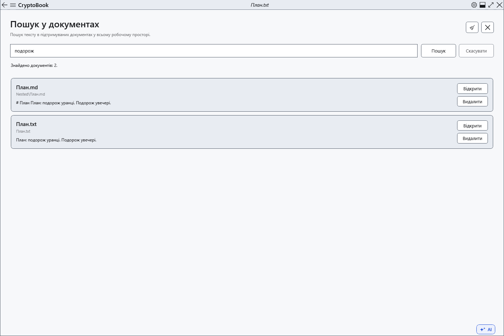
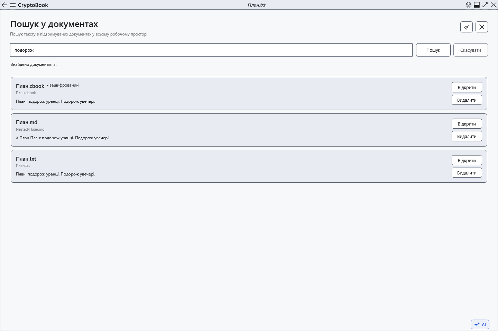

# Пошук у вмісті документів

Пошук вмісту показує файли з потрібним текстом і фрагмент першого збігу. Область — локальна робоча папка з доступними підпапками. Незбережені зміни редактора до пошуку файлів не входять.

## Перед початком

> **Видалити** біля результату видаляє сам файл після підтвердження. Цей шлях зараз видаляє безпосередньо через провайдер, без відновлення з кошика Windows. Якщо потрібен кошик, використовуйте файловий менеджер.

Підтримуються TXT, LOG, MD, CS, XAML, JSON, XML, RTF і XamlPackage. PDF та розпізнавання тексту зображень не підтримуються. Звичайне обмеження файла — 16 МіБ, видачі — 200 файлів.

## Порядок дій

1. У бічному меню відкрийте **Робочий простір → Пошук у документах**.
2. Введіть буквальний текст або фразу й натисніть **Пошук**. Регістр не враховується; фраза шукається як один рядок. Для зупинки натисніть **Скасувати**.
3. Перегляньте назву, відносну папку та фрагмент. **Відкрити** відкриває файл без переходу до збігу; потім скористайтеся пошуком у документі.
4. **Очистити** очищає запит і результати; **Закрити** повертає до активного редактора.

## Перевірка результату

Кожен файл має одну картку. Захищені документи позначено окремо. За їх наявності запитується ключ; скасування введення пропускає їх. Захищений вміст шукається в пам’яті й не записується в пошуковий індекс.

Markdown шукається як збережений вихідний текст, включно з розміткою.

## Скасування й повернення

Скасування зупиняє поточний пошук. Очищення видачі не видаляє файлів. Закриття сторінки також зупиняє пошук.

## Якщо не вдалося

Спочатку збережіть зміни документа. Перевірте повідомлення про пропущені, великі, непідтримувані або недоступні файли. Захищеним документам потрібен відповідний ключ.

## Пов’язані теми

- [Пошук у поточному документі](help:search.document)
- [Ключ і пароль](help:security.password)
- [Два редактори, перейменування та закриття](help:doc.switch)
