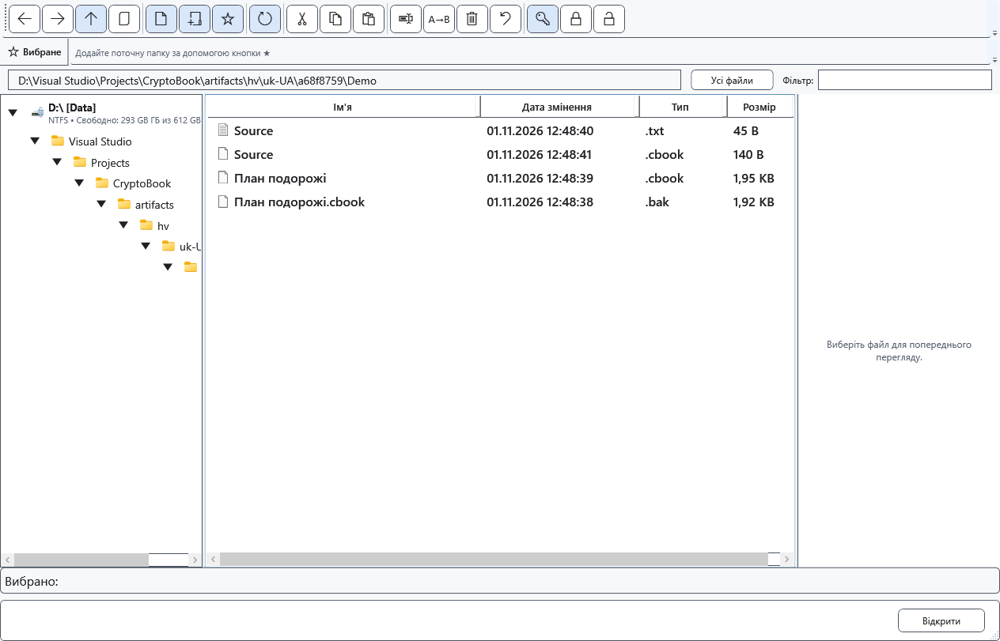

# Сумісність захищених файлів

Назва й розширення не доводять, що файл захищений. CryptoBook визначає контейнер за вмістом. Шифрування на місці може зберегти старе розширення; перевірені окремі копії мають .cbook. .cbox також розпізнається як захищений контейнер.

## Відкриття та перенесення

1. Відкрийте файл через CryptoBook із початковим ключем. Нові файли використовують поточний формат; читання попереднього формату збережено. Перейменування розширення не перетворює вміст і не знімає пароль.
2. Порівняйте текст і оформлення. Усередині захищеного документа редактора може зберігатися XamlPackage, а не звичайний текст. Зображення, відео та інші двійкові файли не стають редагованим текстом після захисту.
3. Для іншої програми явно розшифруйте у відповідний початковий формат або RTF. TXT обирайте лише за згоди втратити оформлення й нетекстові елементи.

## Ключ і помилки

Старий короткий пароль може прийматися для читання; нове шифрування потребує пароля за поточними правилами. Змінивши ключ під час збереження, перевірте й .bak: несумісна з новим ключем копія замінюється поточним захищеним файлом і може вже не містити попередню версію.

При неправильному ключі, пошкодженні чи непідтримуваному вмісті не перезаписуйте єдиний оригінал. Перевірте окрему збережену копію. Пароль Windows не замінює ключ CryptoBook; універсального відновлення забутого пароля немає. Скасування відкриття залишає файл на диску.

- [Формати документів](help:doc.formats)
- [Розшифрування](help:security.decrypt)
- [Попередня версія .bak](help:recovery.backup)
