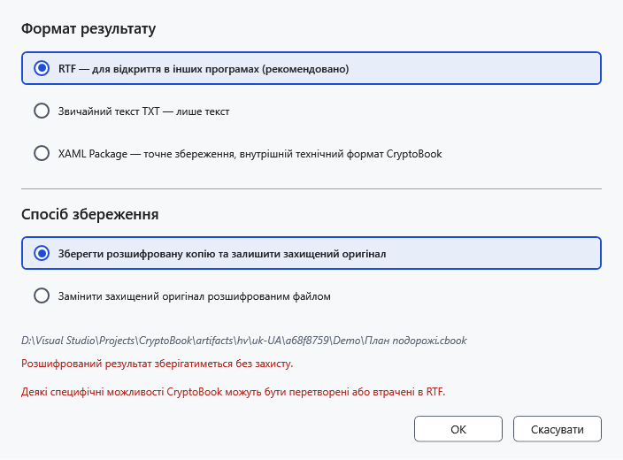
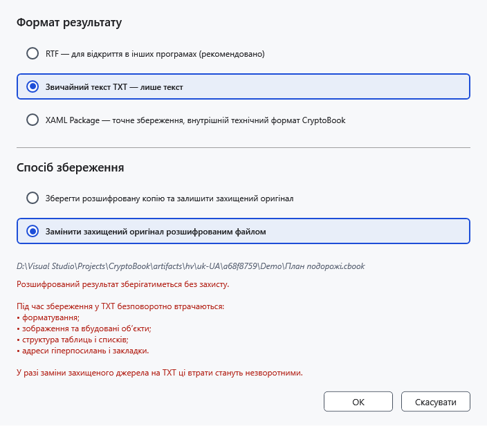

# Розшифрування файлів і папок

Розшифрований результат доступний без ключа. Перед заміною захищеного джерела переконайтеся, що хочете залишити відкриті дані, і перевірте формат.

## Порядок дій

1. Виділіть захищений файл у файловому менеджері й виберіть **Розшифрувати вибрані елементи**. Потрібен ключ, яким його створено.
2. Для окремого .cbook/.cbox виберіть формат. **RTF — для відкриття в інших програмах (рекомендовано)** підходить для інших редакторів. TXT зберігає лише текст без зображень, таблиць і оформлення. Початковий формат зберігає початковий вміст. Перелік залежить від вмісту контейнера, а не лише його назви.
3. Виберіть **Зберегти розшифровану копію та залишити захищений оригінал** або **Замінити захищений оригінал розшифрованим файлом**. Для копії вкажіть місце; заміна видаляє захищене джерело після успішної публікації результату й потребує окремого підтвердження.

Заміна з TXT додатково попереджає про втрату оформлення. Не підтверджуйте її, якщо потрібні зображення або таблиці. Збережіть захищений оригінал для повернення.

## Папка, пакет і результат

Для папки/кількох об’єктів діє окремий вибір копії чи заміни. Папка обробляється рекурсивно; звичайні файли під час розшифрування пропускаються. Копіювання зберігає наявні файли призначення, конфліктним копіям призначаються унікальні назви. Відкрийте результат у відповідному редакторі й перевірте текст та оформлення.

На Android можна розшифрувати доступний для читання файл; для заміни потрібні також запис і видалення. Це не означає підтримки шифрування всієї віддаленої папки.

## Скасування та помилки

**Скасувати** у параметрах скасовує публікацію; під час перебігу слід дочекатися зупинки. Завершені елементи можуть залишитися. Якщо ключ неправильний, повторіть початковий пароль; при помилці запису перевірте доступ і вільне місце, не видаляючи контейнер до перевірки результату.

- [Захист](help:security.protect)
- [Обмеження пристроїв](help:devices.limits)
- [Формати](help:doc.formats)
