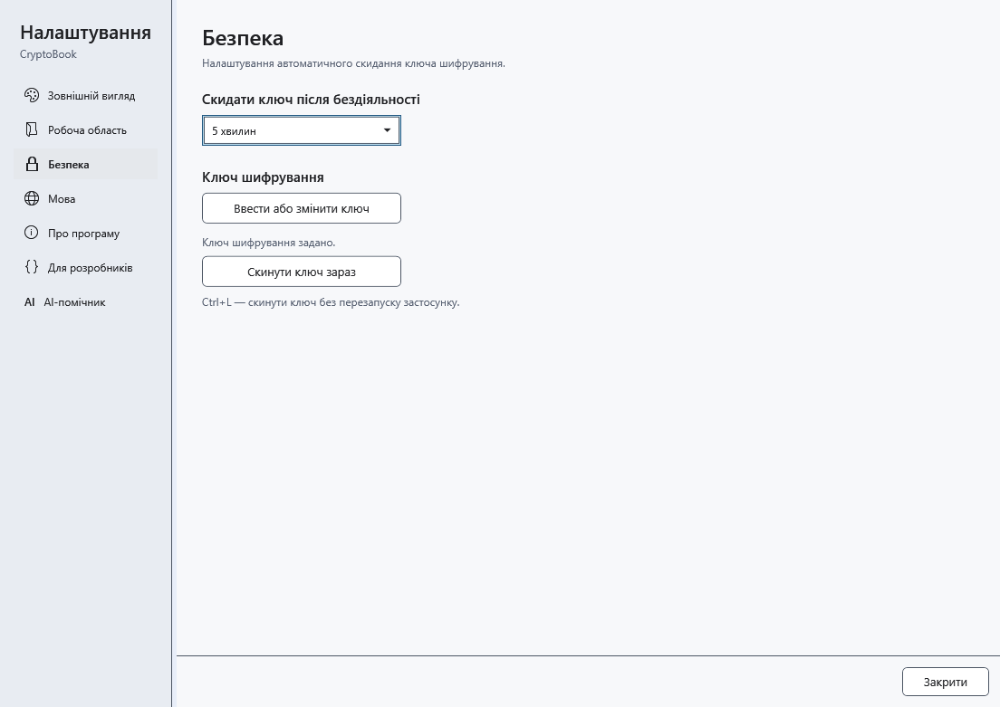
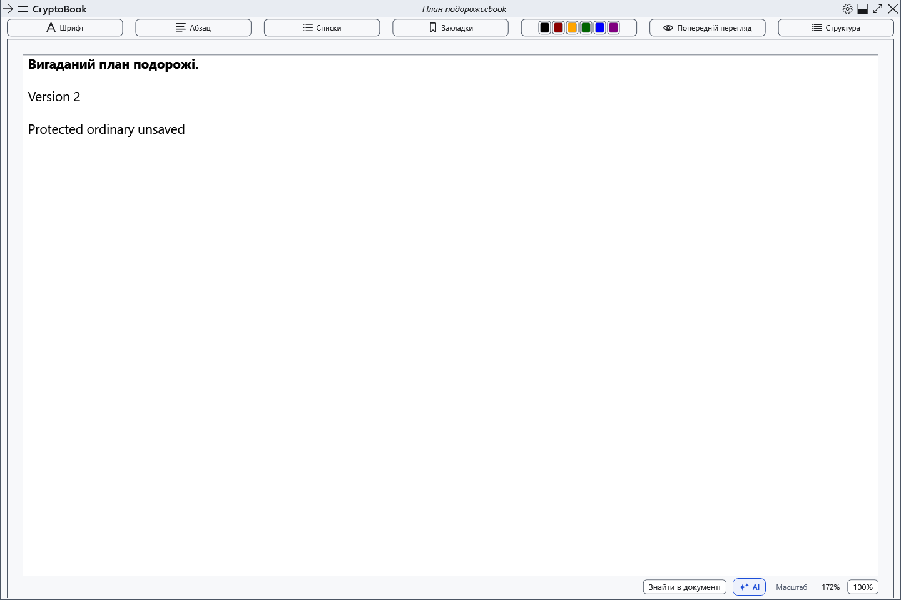

# Скидання ключа та блокування

Ctrl+L видаляє ключ із пам’яті програми. Якщо відкрито лише звичайні документи, вони залишаються відкритими з незбереженими змінами: сам ключ не робить їх захищеними.

## Налаштування

1. Відкрийте налаштування → **Безпека**.
2. У **Скидати ключ після бездіяльності** виберіть 1, 5, 10, 15 чи 30 хвилин або **Ніколи**. Інтервал діє одразу; типовий — 15 хвилин. Дії всередині CryptoBook поновлюють відлік, тривалі файлові операції його призупиняють.
3. Для негайного скидання натисніть Ctrl+L у головному вікні/налаштуваннях або **Скинути ключ зараз**. Без ключа скидати нічого. Втрата фокусу не є скиданням; блокування сеансу Windows і перехід у сон викликають безпечне скидання.

## Захищена робота

Програма зберігає й перевіряє захищений знімок, потім очищує ключ і захищені редактори. Якщо захищені обидва незалежні документи, знімок містить обидва. Якщо лише один, звичайний сусід залишається окремо в робочому просторі. Вікна з вмістом приховуються/закриваються, робота AI припиняється.

Після успішного скидання можна продовжити звичайну роботу. Відновлення знімка доступне за вашою командою в бічному меню. Якщо знімок не вдалося створити, ключ усе одно скидається, а незбережений захищений документ залишається прихованим у пам’яті за екраном блокування. **Не закривайте програму:** розблокуйте колишнім паролем і збережіть роботу.

## Повернення

Відкрийте бічне меню → **Файл** → **Відновити знімок після скидання ключа**. Для роботи, прихованої в пам’яті після помилки знімка, скористайтеся **Розблокувати**. Скасування введення зберігає знімок. **Ніколи** вимикає таймер бездіяльності; ручне скидання та системні події залишаються.

- [Варіанти відновлення знімка](help:recovery.lock)
- [Ключ](help:security.password)
- [Життєвий цикл AI](help:ai.lifecycle)
