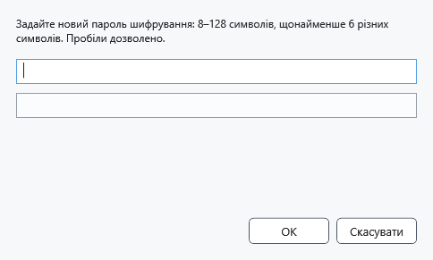
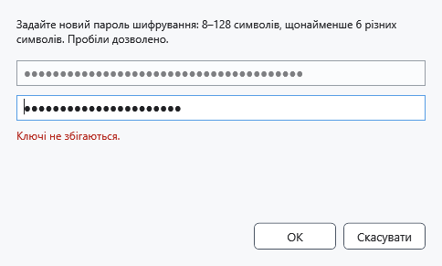

# Ключ і пароль шифрування

Ключ потрібен для відкриття захищених файлів. Уведення іншого ключа не змінює пароль уже збережених файлів. Надійно збережіть свій пароль: CryptoBook не пропонує його скидання чи відновлення через пароль Windows.

## Порядок дій

1. Відкрийте налаштування → **Безпека** → **Ввести або змінити ключ**. У файловому менеджері є **Встановити ключ шифрування**. Під час відкриття захищеного файла запит з’являється автоматично, якщо ключа немає.
2. Для нового шифрування задайте 8–128 символів, щонайменше шість різних без урахування регістру. Пробіли дозволені; лише цифри, повторювані послідовності й поширені слабкі поєднання відхиляються. Обирайте довгий унікальний пароль.
3. Уведіть пароль у верхнє поле й натисніть Enter: нижнє поле стане доступним. Повторіть той самий пароль і натисніть **ОК** або Enter. Символи приховані; кнопки показу пароля тут немає.

Якщо значення різні, виправте обидва поля. Для читання старого файла дозволено його колишній пароль, навіть якщо він не відповідає правилам нового шифрування; нове збереження може вимагати сильнішого пароля.

## Результат, скасування та помилки

У налаштуваннях з’явиться **Ключ шифрування задано.**. Це означає наявність ключа в пам’яті, а не його відповідність усім файлам. Для конкретного файла відповідність перевіряється під час відкриття. **Скасувати** закриває введення. Якщо файл не відкривається, перевірте початковий пароль і цілісність окремої копії; не замінюйте єдиний оригінал. Ctrl+L очищує збережений у пам’яті ключ.

- [Захистити документи](help:security.protect)
- [Скинути ключ](help:security.lock)
- [Відновити знімок блокування](help:recovery.lock)
