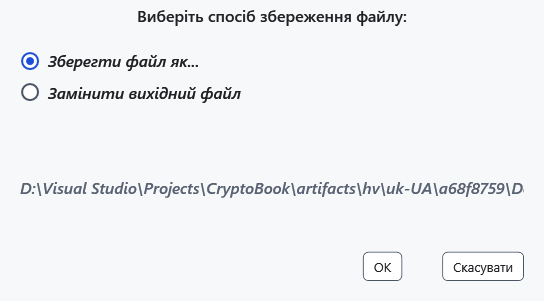
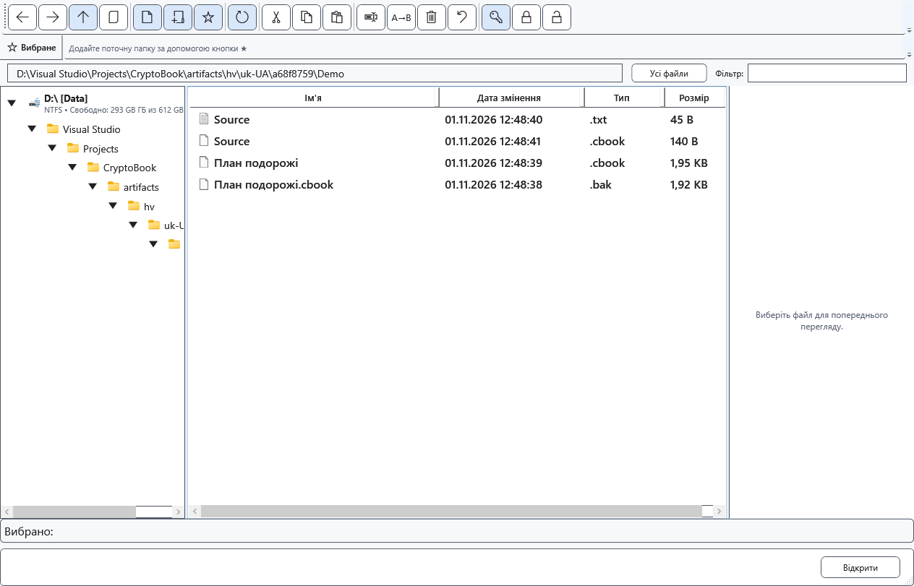

# Захист документів і файлів

Захищена копія дає змогу перевірити шифрування, зберігши джерело. Звичайний початковий файл залишається доступним для читання. Перед заміною переконайтеся, що знаєте пароль і маєте потрібну окрему копію: загального скасування вже виконаного шифрування немає.

## Документ редактора

Виберіть **Зберегти як**, захищений формат .cbook і місце призначення. Прочитайте попередження та підтвердьте запис; за потреби задайте новий ключ. Під час збереження звичайного файла зі встановленим ключем програма може запропонувати захищену копію. Потім перевірте шлях поточного документа: звичайний оригінал автоматично не видаляється.

## Файли та папки

1. Виділіть файли у файловому менеджері та виберіть **Створити захищені копії (.cbook)**. Для одного файла копія створюється поруч, для кількох виберіть папку. Результат перевіряється, наявні файли зберігаються, збіги назв отримують унікальні назви; уже захищені файли пропускаються. Ця команда не обробляє папки.
2. Для іншого режиму виберіть **Зашифрувати або замінити вибрані елементи…**. Для окремого файла доступні **Зберегти файл як...** та **Замінити вихідний файл**. Заміна потребує підтвердження.

3. Шифрування папки цією командою виконується на місці й рекурсивно після попередження. Пакет із кількох об’єктів також замінює джерела. Обіцянка збереження оригіналів для захищених копій тут не діє. Цілий диск шифрувати не можна; можливості пристрою перевіряйте окремо.

## Перевірка та скасування

Відкрийте результат правильним ключем і порівняйте вміст. Після заміни старе розширення може залишитися: орієнтуйтеся на вміст і успішне відкриття. До підтвердження виберіть **Скасувати**; під час обробки скасуйте у вікні перебігу й дочекайтеся завершення. Завершені елементи пакета можуть залишитися зміненими. При помилці перевірте кожний результат, права та місце, зберігаючи оригінали.

- [Розшифрувати](help:security.decrypt)
- [Сумісність](help:security.compatibility)
- [Помилки запису](help:recovery.write)
