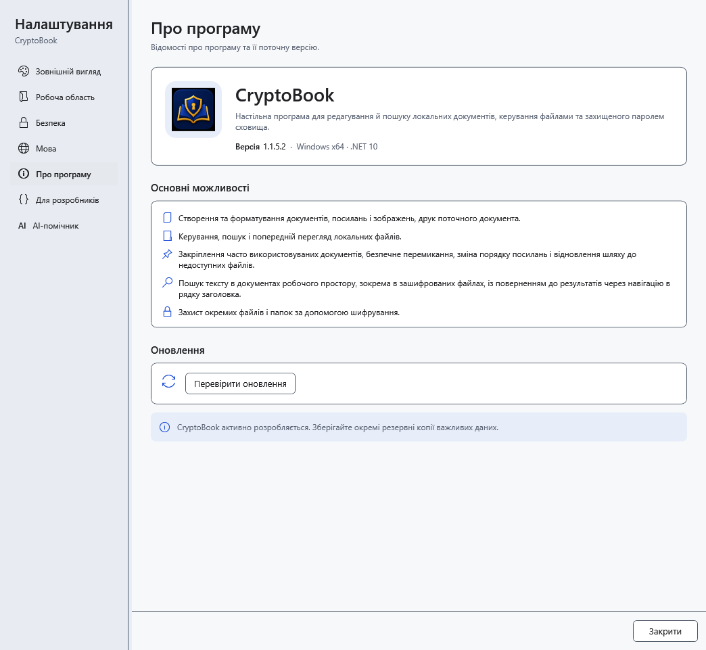
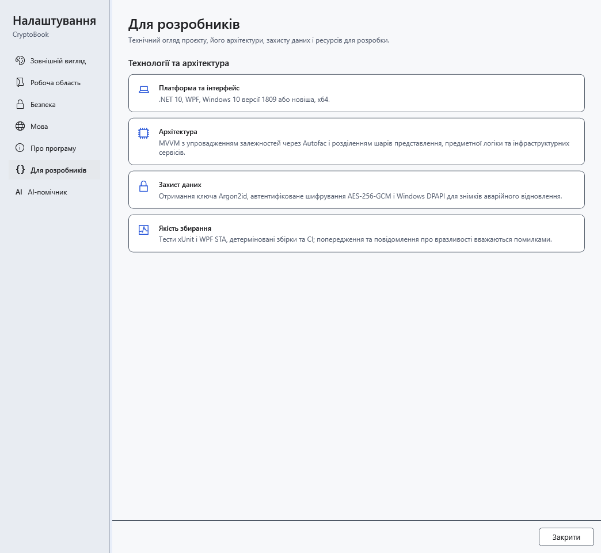

# Версія та відомості про програму

Перш ніж повідомляти про проблему, дізнайтеся версію **запущеної** програми. Запуск старої portable-папки може відкрити іншу версію, ніж нещодавно встановлена.

1. Відкрийте **Налаштування → Про програму**.
2. Знайдіть **Версія** біля назви CryptoBook. Додайте це значення, версію Windows і послідовність дій до опису проблеми.

3. Розділ **Для розробників** описує платформу, архітектуру, захист і перевірки проєкту.

Ці відомості не перевіряють конкретний файл, комп'ютер або резервну копію. Тут немає засобу відновлення пароля. Перевірка нової версії міститься в **Про програму**, у блоці **Оновлення**. Закрийте налаштування, щоб повернутися до роботи: читання відомостей не змінює документ.

- [Оновлення програми](help:settings.updates)
- [Типові проблеми](help:settings.troubleshoot)
- [Установлення та portable](help:start.install)
