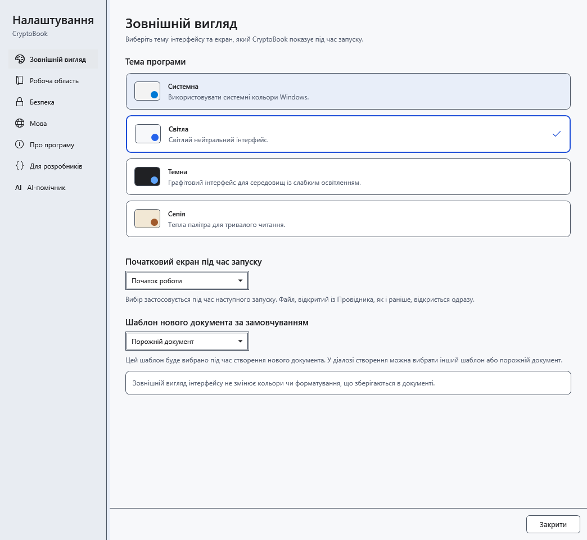
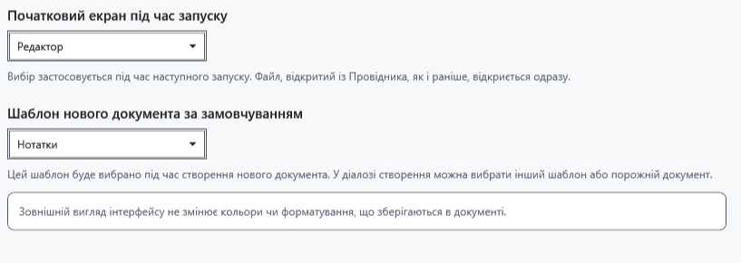

# Тема, початковий екран і шаблон

Відкрийте **Налаштування → Зовнішній вигляд**. Тут змінюється вигляд програми й початковий вибір для нової роботи. Відкритий документ зберігає власне оформлення.

## Змінення параметрів

1. Виберіть **Світла**, **Темна**, **Системна** або **Сепія**. Тема застосовується та зберігається одразу. Системний варіант відповідає світлому або темному режиму Windows.

2. У **Початковий екран під час запуску** виберіть початок роботи або редактор. Вибір діє під час наступного запуску; відкриття конкретного файла з Провідника має пріоритет. Поточний документ не закривається, екран негайно не перемикається.
3. У **Шаблон нового документа за замовчуванням** виберіть шаблон. Його буде запропоновано під час наступного створення документа; у діалозі можна вибрати інший шаблон або порожній документ.

## Перевірка та повернення

Закрийте й знову відкрийте налаштування: вибір має зберегтися. Окремої кнопки застосування тут немає; закриття не скасовує зміни. Для повернення виберіть попередню тему, екран або шаблон. Роздільник ліворуч змінює ширину навігації налаштувань.

Тема не перефарбовує збережений текст, фон аркуша чи зображення. Змінюйте їх у редакторі; оформлення AI має окремі параметри. Якщо початковий екран не змінився в поточному вікні, це очікувано: збережіть роботу й перевірте наступний звичайний запуск.

- [Шаблони документів](help:doc.templates)
- [Кольори тексту](help:edit.font)
- [Мова інтерфейсу](help:settings.language)
- [Оформлення AI](help:ai.appearance)
