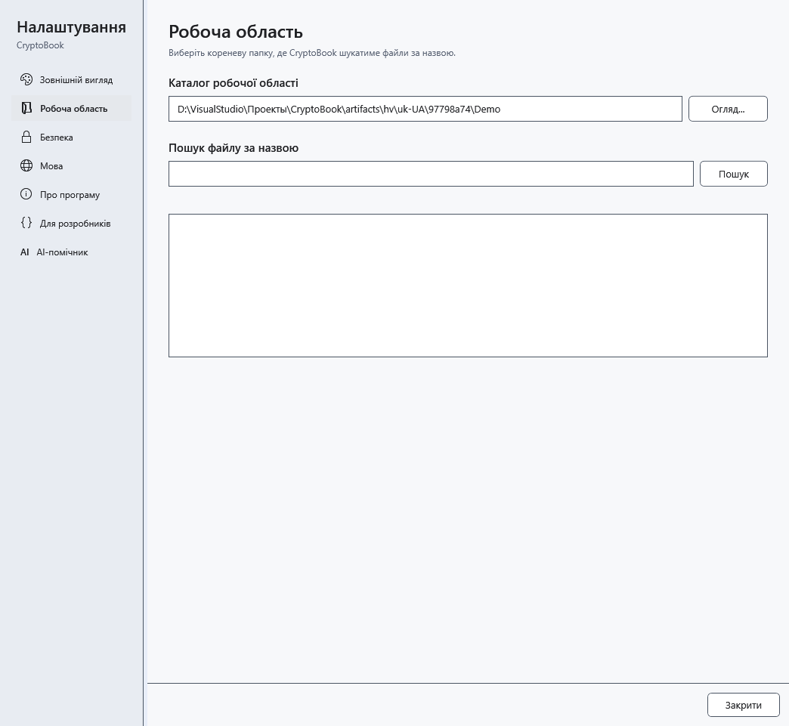

# Де зберігаються дані й налаштування

Робоча директорія — папка документів, а не весь профіль CryptoBook. Установлена й portable-версії використовують дані поточного користувача Windows поза папкою з exe.

## Що резервувати

| Дані | Де шукати та що врахувати |
| --- | --- |
| Документи, захищені файли, `.bak` | У вибраних вами папках; `.bak` біля оригіналу — одна попередня версія, не архів усіх змін |
| Тема, мова, початковий екран, шаблон, розміри вікон і довідка | `user.config` у локальному профілі Windows; підпапки залежать від версії та шляху запуску |
| Обране, закріплені й нещодавні документи | `%LOCALAPPDATA%\CryptoBook\favorites.json`, `pinned-documents.json`, `recent-documents.json`; це посилання й шляхи, не копії документів |
| Параметри AI, інструкції шаблонів і профілі продуктивності | Там само `ai-settings.json`, `ai-runtime-profiles.json`; GGUF та mmproj залишаються у вибраних вами папках |
| Перевірки оновлень і пропущений номер | Там само `update-check.json` |
| Індекс пошуку звичайних документів | Там само `Search\*.db`: може містити текст звичайних файлів; розшифрований текст захищених документів туди не записується |
| Діагностика аварійного збереження | Там само `Logs\recovery.log`; перед передаванням звіту перевірте особисті шляхи |
| Аварійне відновлення / знімок скидання ключа | Підпапки `Recovery` / `Lock`; це різні механізми, не заміна резервної копії |

Введіть `%LOCALAPPDATA%` в адресний рядок Провідника Windows. Не редагуйте службові файли під час роботи програми. Чат AI між запусками не зберігається; важливу відповідь заздалегідь перенесіть у документ. Пароль шифрування не відновлюється з налаштувань. Знімки із захистом Windows залежать від її профілю; перенесення папки на інший комп'ютер не гарантує їх читання.

## Оновлення та перенесення

Перед оновленням збережіть і закрийте програму, окремо скопіюйте важливі документи. Програма намагається перенести сумісні налаштування попередньої версії, але це не перенесення всіх даних на інший комп'ютер. Після запуску перевірте мову, тему, робочу папку, шляхи закріплених файлів і моделей. Недоступне посилання не означає видалення документа: знайдіть оригінал і відновіть шлях.

Службові JSON можуть містити шляхи та введені інструкції. Не публікуйте весь профіль у звіті про помилку. Перед повним резервуванням закрийте програму; не видаляйте `Recovery` чи `Lock` до перевірки відновлення. Тимчасові файли оновлень містяться в `%TEMP%\CryptoBook\Updates`, а не в робочій папці.

- [Оновлення](help:settings.updates)
- [Аварійне відновлення](help:recovery.crash)
- [Знімок скидання ключа](help:recovery.lock)
- [Шаблони AI](help:ai.templates)
- [Закріплені документи](help:files.pinned)
