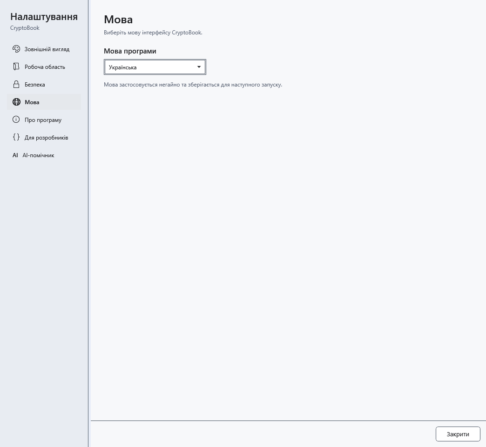

# Мова програми та довідки

CryptoBook підтримує English, Русский, Українська та Deutsch. Вибір змінює інтерфейс і вбудовану довідку; введений вами текст і відповіді AI автоматично не перекладаються.

1. Відкрийте **Налаштування → Мова**.
2. У **Мова програми** виберіть потрібну мову. Вона застосовується одразу й зберігається для наступного запуску.

## Що відбувається з відкритою довідкою

Поточна тема залишається тією самою, але показується її переклад. Запит і результати пошуку очищуються, позиції прокручування в історії повертаються на початок. Це запобігає переходам за результатами попередньою мовою. Введіть запит новою мовою знову.

Закриття налаштувань не скасовує вибір; поверніть попередню мову тим самим списком. Якщо слово не змінилося, перевірте, чи є воно вмістом документа, назвою файла, моделі або власною назвою: такі дані не перекладаються. Для відповіді AI іншою мовою змініть інструкцію в шаблоні спілкування.

- [Користування довідкою](help:help.use)
- [Оформлення програми](help:settings.appearance)
- [Шаблони спілкування AI](help:ai.templates)
