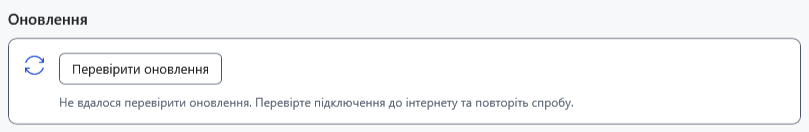

# Типові проблеми та безпечні дії

Спочатку окремо збережіть доступну роботу, запишіть точне повідомлення, версію програми й кроки. Не видаляйте оригінал, `.bak`, `Recovery` чи `Lock` для виправлення незрозумілої помилки. Для перевірки використовуйте копію звичайного документа.

| Ознака | Що перевірити та зробити |
| --- | --- |
| Кнопка недоступна | Активний документ, вибір, режим читання й поточну операцію. Для групового перейменування потрібні щонайменше два придатні файли. Поверніть фокус у потрібне вікно |
| Не вдається зберегти | Вільне місце, права запису, доступність папки й блокування іншою програмою. Спробуйте зберегти в іншій доступній папці; оригінал не видаляйте |
| Документ виглядає інакше | Перевірте розширення: TXT не зберігає оформлення, Markdown містить вихідний текст. Перевірте попередній перегляд і вибраний редактор |
| Нещодавнє чи закріплене посилання недоступне | Диск міг від'єднатися, файл — переміститися. Підключіть джерело або відновіть шлях; запис списку не є копією файла |
| Захищений файл не відкривається | Перевірте файл і пароль. Неправильний ключ, пошкодження та несумісний формат потребують різних дій; зміна розширення не розшифровує файл. Пароль із налаштувань не витягується |
| Робота зникла після скидання ключа | Скористайтеся відновленням знімка в меню Файл і попереднім ключем; за помилки знімка не закривайте процес до повернення прихованої роботи |
| Android не видно | Розблокуйте пристрій, увімкніть передачу файлів USB/MTP, перевірте кабель і підключення. Не повторюйте переміщення навмання: перевірте обидва кінці операції |
| PDF чи відео не відкривається | Для PDF потрібна асоційована програма Windows; для відео важливі формат і доступність джерела. Зміна пароля не виправляє відсутність системного обробника |
| AI не надсилає або не завантажується | Прочитайте причину недоступності та стан моделі; перевірте GGUF, відповідний проєктор зображень, контекст і пам'ять. Не повторюйте запуск без перевірки причини |
| Довідка не знаходить слово | Виберіть мову, скоротіть запит, використайте слова статті. Пошук довідки відокремлений від пошуку документів і файлів; зміст очищує запит |

За помилки оновлення перевірте мережу, GitHub, дозволи й місце в тимчасовій папці. За невідповідності суми або помилки підпису не запускайте файл вручну. Якщо після зміни portable-папок налаштування здаються скинутими, перевірте запущену версію та попередній профіль; збережіть старі дані до перевірки.

Для звіту достатньо версії, кроків, формату й знеособленого прикладу. Не додавайте пароль, ключ, увесь профіль, особисті документи чи чат.

- [Помилки запису](help:recovery.write)
- [Обмеження пристроїв](help:devices.limits)
- [Помилки AI](help:ai.troubleshoot)
- [Оновлення](help:settings.updates)
- [Дані користувача](help:settings.data)
