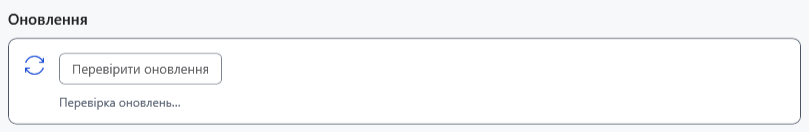
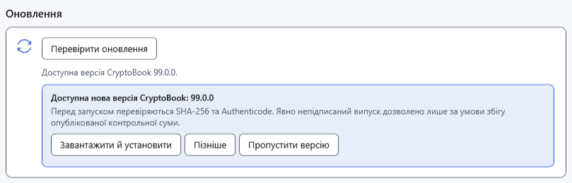

# Перевірка та встановлення оновлення

Перевірка знаходить нову стабільну версію; установлення окремо завантажує й запускає інсталятор. Перед установленням збережіть усі звичайні та Markdown-документи й окремо скопіюйте важливі файли. Чат AI між запусками не зберігається.

## Перевірити версію

1. Відкрийте **Налаштування → Про програму** і знайдіть **Оновлення**; за потреби прокрутіть униз.
2. Натисніть **Перевірити оновлення** і дочекайтеся завершення **Перевірка оновлень…**.

Якщо нової версії немає, з'явиться **Установлено останню версію CryptoBook.**. Фонова перевірка відбувається під час запуску, якщо від попередньої минуло щонайменше 24 години; це не постійний таймер. Ручна перевірка обходить цей інтервал і раніше пропущену версію.

## Вибрати дію

- **Пізніше** приховує поточне сповіщення, не записуючи пропуск версії.
- **Пропустити версію** зберігає саме цей номер і приховує його під час фонових перевірок. Іншу нову версію це не блокує.
- **Завантажити й установити** завантажує інсталятор. Перевіряються адреси файлів випуску, SHA-256 і стан Authenticode. Явно непідписаний випуск допускається за збігу суми; недійсний підпис або невідповідність суми відхиляються. Потім запускається інсталятор із підвищенням прав, а програма завершує роботу. Старе джерело без файла інсталятора може натомість відкрити сторінку випуску.

Вбудоване оновлення використовує інсталятор і для portable. Для оновлення через ZIP виконайте окрему інструкцію встановлення. Завантаження використовує тимчасову папку Windows; скасування чи помилка зупиняє операцію й видаляє незавершений `.download`. Після запуску окремого інсталятора скасування вже стосується його вікна. Після успішного встановлення запустіть CryptoBook і перевірте версію, налаштування та документи.

## Якщо перевірка або встановлення не вдалися

За **Не вдалося перевірити оновлення. Перевірте підключення до інтернету та повторіть спробу.** перевірте доступ до інтернету/GitHub і повторіть пізніше. Для помилки завантаження перевірте місце в TEMP і дозволи. Якщо перевірка цілісності відмовила, не запускайте файл вручну: повторіть завантаження з довіреного джерела. Відмова в UAC не встановлює оновлення. Не видаляйте профіль або документи для усунення помилки оновлення.

- [Установлення та portable](help:start.install)
- [Дані користувача](help:settings.data)
- [Збереження документів](help:doc.save)
- [Типові проблеми](help:settings.troubleshoot)
