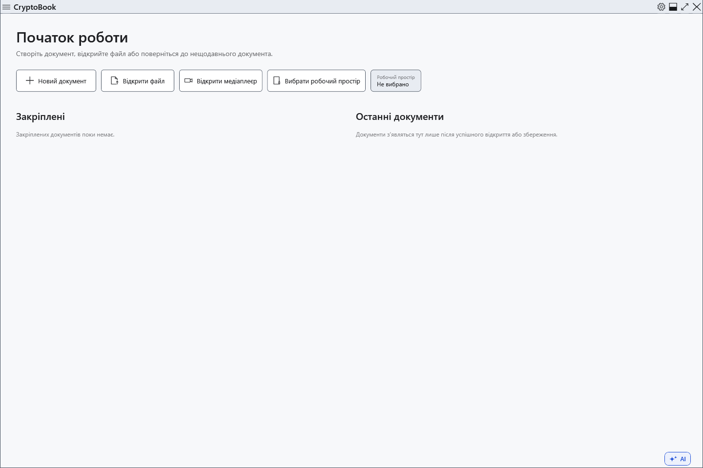

# Установлення та запуск portable

CryptoBook працює у Windows 10 версії 1809 або новішій, x64. Офіційна поставка містить середовище .NET; окреме встановлення Desktop Runtime не потрібне. Моделі AI встановлюються окремо.

## Виберіть спосіб запуску

1. Для встановлення візьміть `CryptoBook-Setup-<версія>.exe` з випусків проєкту. До запуску порівняйте SHA-256 із записом у `SHA256SUMS.txt` того самого випуску; стан підпису вказано в `SIGNING-STATUS.txt`.
2. Збережіть документи та закрийте CryptoBook. Запустіть інсталятор, підтвердьте підвищення прав у Windows, виберіть папку програми та за потреби ярлик. Не зберігайте особисті документи в папці встановлення: оновлення замінює та видаляє там службові файли.
3. Для portable розпакуйте **весь** `CryptoBook-win-x64.zip` в окрему папку й запустіть `CryptoBook.exe`. Не запускайте з ZIP і не переносьте лише exe без решти файлів поставки.

Інсталятор реєструє CryptoBook у «Відкрити за допомогою» Windows для `.cbook` та `.cbox`; типову програму вибираєте ви. Portable не виконує цю реєстрацію автоматично.

## Перший запуск та оновлення

Відкрийте **Налаштування** кнопкою в рядку заголовка. Мову, тему й робочу директорію можна вибрати без створення захищеного документа. Для шифрування потрібен власний пароль; установлення його не створює.

Portable використовує профіль Windows для налаштувань, історії та відновлення, як і встановлена версія. Папка з exe не є повною переносною копією ваших даних. Вбудоване оновлення запускає інсталятор; щоб і далі працювати через ZIP, розпакуйте нову поставку в нову папку й запустіть її звідти після закриття старої версії.

Якщо запуск не вдається, перевірте версію Windows, x64, повне розпакування та вільне місце в TEMP. Windows може попередити про непідписаний файл; спершу перевірте джерело, суму й декларацію підпису. Не вимикайте захист Windows для невідомого файла. Установлену програму можна видалити засобами Windows; документи зберігайте окремо та самостійно резервуйте.

- [Параметри інтерфейсу](help:settings.appearance)
- [Оновлення](help:settings.updates)
- [Дані користувача](help:settings.data)
