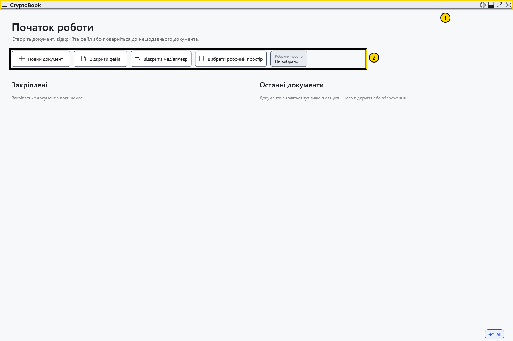
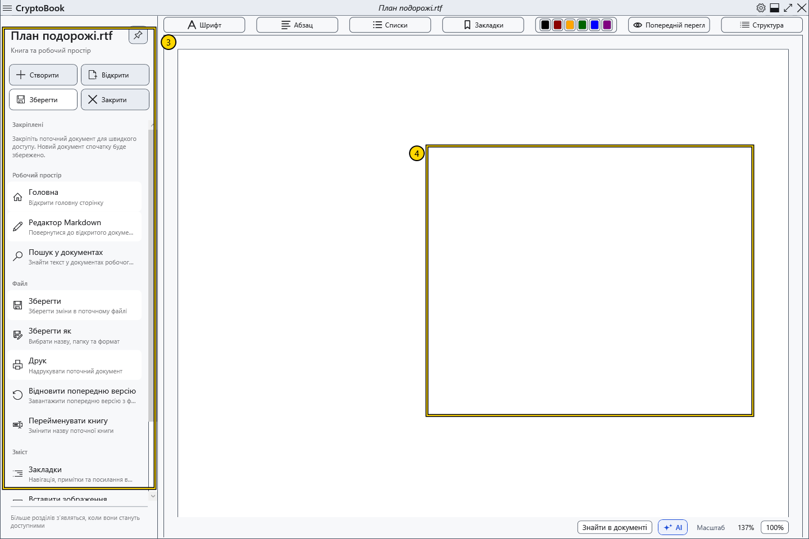
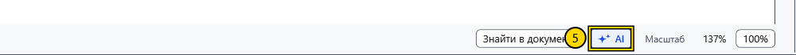

# Основні області вікна

На початковому екрані можна створити або відкрити документ. Після відкриття документа центральна частина вікна стає областю читання та редагування.

## Де що розташовано

1. **Верхній рядок.** Ліворуч розташовані стрілки назад і вперед та кнопка меню з трьома горизонтальними лініями. Стрілки перемикають сторінки програми. Посередині відображається ім’я документа. Шестірня праворуч відкриває **Налаштування**; поруч розташовані кнопки керування вікном.
2. **Початковий екран.** **Новий документ** відкриває діалог створення, **Відкрити файл** — вибір файлу, **Вибрати робочий простір** — вибір папки для пошуку в робочому просторі. Тут також видно закріплені та нещодавні документи, якщо відповідні списки заповнені.

3. **Бічне меню.** Відкрийте його кнопкою з трьома лініями. Серед швидких дій є **Створити**, **Відкрити**, **Зберегти** та **Закрити**. Нижче команди згруповані в розділи **Робочий простір**, **Файл** і **Зміст**. Відкривайте меню, щоб знаходити команди за інструкцією.
4. **Область документа.** Над текстом звичайного документа розташовані панелі форматування. Для Markdown використовується окремий редактор. Перехід між сторінками не перетворює один документ на інший; перед збереженням перевірте, який редактор активний.

5. **Нижня частина звичайного редактора.** Тут розташовані пошук у документі, кнопка **AI-помічник** і керування масштабом. Панель помічника відкривається праворуч, коли вона доступна. Для роботи помічника потрібне окреме налаштування.

## Спробуйте

Відкрийте й закрийте бічне меню, потім відкрийте **Налаштування** шестірнею. Закрийте вікно налаштувань, щоб повернутися до документа. Якщо поки видно початковий екран, створіть демонстраційний документ, щоб побачити елементи редактора.

## Пов’язані теми

- [Створити та зберегти документ](help:doc.create)
