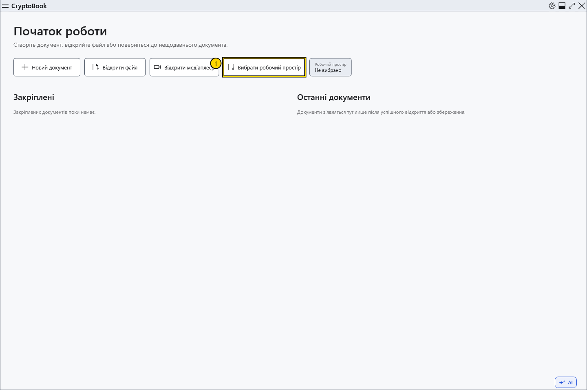
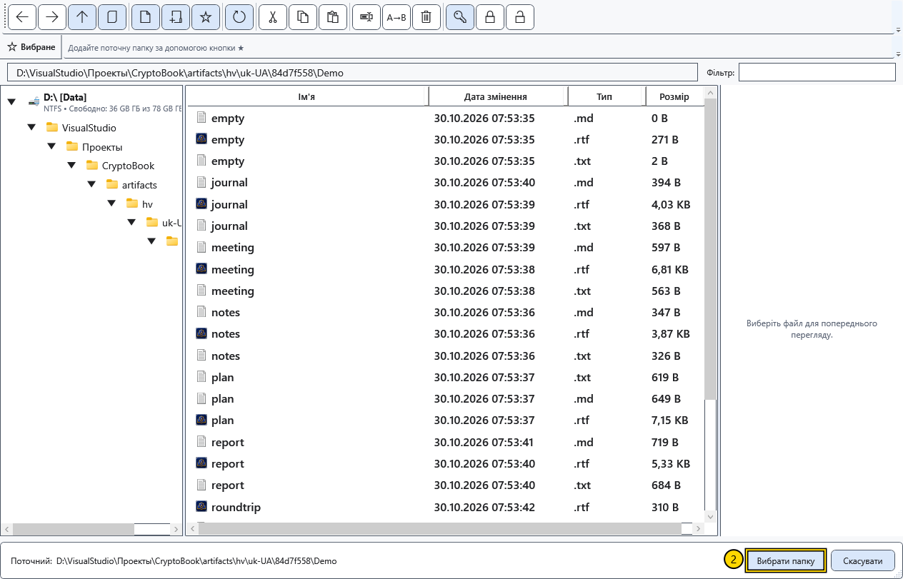
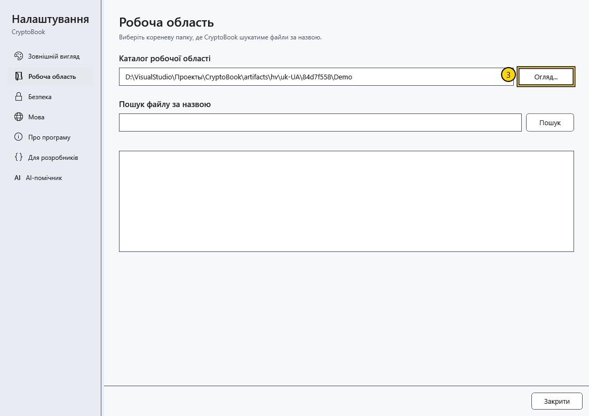

# Вибрати робочу директорію

Робоча директорія задає папку для пошуку документів. Наприклад, виберіть папку проєкту, щоб шукати його файли за назвою або вмістом. Для створення чи відкриття окремого документа вибирати робочу директорію необов’язково.

## Порядок дій

1. На початковому екрані натисніть **Вибрати робочий простір**. Якщо відкрито редактор, скористайтеся шестірнею **Налаштування → Робоча область → Огляд...**.

2. У вікні вибору перейдіть до потрібної локальної папки. Перевірте шлях унизу та підтвердьте вибір. **Скасувати** залишає попередню робочу директорію.

3. Відкрийте **Налаштування → Робоча область** і перевірте показаний шлях. Тут розташовано **Пошук файлу за назвою**; пошук за вмістом відкривається окремою командою робочого простору.

## Три різні шляхи

| Шлях | На що впливає |
| --- | --- |
| Робоча директорія | Область пошуку в робочому просторі |
| Поточна папка файлового менеджера | Список показаних файлів і призначення файлових операцій |
| Папка відкритого документа | Розташування файлу; **Зберегти** записує саме в нього |

Зміна робочої директорії не переміщує відкритий файл, не змінює його назву та не зберігає його в новій папці. Для іншого місця збереження скористайтеся **Файл → Зберегти як**.

## Якщо не вдалося

Якщо папка недоступна, під’єднайте відповідний диск або виберіть наявну локальну папку. Порожній результат пошуку не означає, що відкритий документ видалено: спочатку перевірте область пошуку та назву. Змінити вибір можна тією самою кнопкою; раніше записані файли від цього не видаляються.

## Пов’язані теми

- [Основні області вікна](help:start.interface)
- [Відкрити документ](help:doc.open)
- [Зберегти та «Зберегти як»](help:doc.save)
- [Навігація файлами](help:files.navigate)
- [Пошук за назвою](help:search.name)
- [Пошук за вмістом](help:search.workspace)
