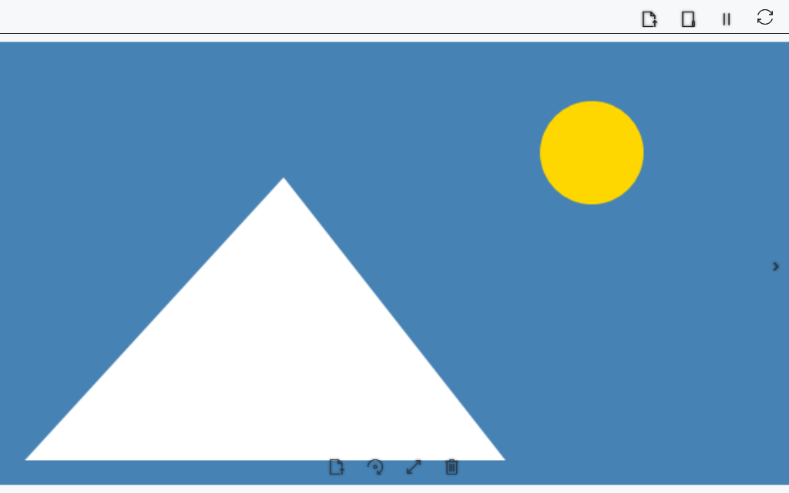

# Перегляд зображень у медіаплеєрі

Медіаплеєр відкриває зображення в окремому вікні. Поворот, масштаб і зміщення змінюють відображення без запису нової версії картинки.

## Перед початком

> **Видаляється вихідний файл, зокрема сам .cbook/.cbox, а не розшифрована копія.** Спочатку перевіряються обсяг вихідного файла та вільний ліміт кошика. Якщо місця достатньо, плеєр запитує переміщення до кошика Windows. Якщо кошика немає або місця недостатньо, він пропонує незворотне видалення та чекає окремої згоди. До підтвердження нічого не видаляється.

Використовуйте локальний файл або локальну копію з пристрою. Підтримка декодування залежить від Windows.

## Порядок дій

1. Відкрийте **Зміст → Фото та відео**, натисніть **Відкрити в цьому програвачі** і виберіть зображення. **Відкрити в новому програвачі** відкриває вибраний файл в іншому вікні.
2. **Попереднє зображення** / **Наступне зображення** і ←/→ переходять між зображеннями вибраного каталогу; на краях списку перехід недоступний.
3. Натисніть **Повернути** для повороту. Колесо й ↑/↓ збільшують/зменшують масштаб; перетягування лівою кнопкою зміщує картинку.
4. **Вписати зображення** скидає поворот, масштаб і зміщення.
5. Щоб видалити файл, натисніть **Видалити зображення** або Delete. Дочекайтеся перевірки кошика, перевірте шлях вихідного файла та спосіб видалення в попередженні. Натисніть **ОК** для вказаної дії або **Скасувати**, щоб зберегти файл. Під час операції повторне видалення та перехід до іншого зображення недоступні. Прогрес закривається після відкриття сусіднього зображення або очищення перегляду.

## Перевірка результату

Зображення показано у вікні. Елементи керування з’являються при наведенні та мають підказки. Стрілки без модифікаторів діють на зображення в активному вікні плеєра. Після переміщення файлу до кошика плеєр показує сусіднє зображення; якщо зображень більше немає, область перегляду очищається.

## Скасування й повернення

У запиті видалення натисніть **Скасувати**, щоб зберегти оригінал. Закриття плеєра скасовує ще не виконану частину операції. Після переміщення до кошика відкрийте його, виберіть файл і натисніть **Відновити**, потім знову відкрийте файл у плеєрі. Після підтвердженого незворотного видалення відновлення з кошика неможливе.

## Якщо не вдалося

Немає сусіднього зображення — перевірте каталог і порядок файлів. При помилці декодування спробуйте підтримуваний формат. PDF та відео мають інші способи перегляду.

Якщо ліміт кошика визначити не вдалося, операція зупиняється з повідомленням. Відмова від підтвердження або помилка до видалення зберігає вихідний файл і поточне зображення. Якщо файл уже успішно видалено до скасування, плеєр переходить до сусіднього зображення; скасування не повертає вже видалений файл автоматично.

## Пов’язані теми

- [Відео й кілька вікон плеєра](help:view.video)
- [Відкриття, перейменування й видалення](help:files.manage)
