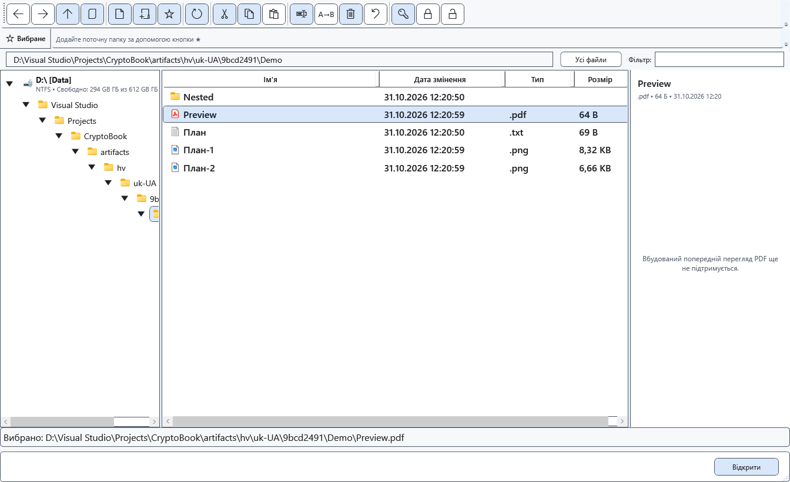

# Відкриття PDF

CryptoBook передає звичайний PDF зовнішній програмі Windows. PDF не стає редагованим документом CryptoBook, а права панель не показує його сторінки.

## Перед початком

Потрібні встановлена програма PDF і налаштована асоціація Windows. Файл Android спершу скопіюйте локально. Не передавайте захищений контейнер зовнішній програмі як звичайний PDF.

## Порядок дій

1. Відкрийте файловий менеджер і виберіть локальний PDF. Праворуч з’явиться повідомлення про відсутність вбудованого перегляду PDF.
2. Відкрийте файл командою **Відкрити**. Windows запустить призначену програму PDF.
3. Читайте, друкуйте чи редагуйте засобами тієї програми. Для повернення активуйте CryptoBook.

## Перевірка результату

Документ з’являється в зовнішній програмі, якщо асоціація доступна. Сторінки PDF не замінюють вміст звичайного редактора CryptoBook.

## Скасування й повернення

Закрийте зовнішнє вікно або поверніться до CryptoBook. Запит збереження змін зовнішньої програми належить до неї.

## Якщо не вдалося

Якщо відкриття не вдалося, налаштуйте типову програму PDF у Windows і повторіть. Зміна розширення не робить PDF редагованим у CryptoBook. Захищений PDF спершу явно розшифруйте у відповідне місце; отриманий файл буде незашифрованим.

## Пов’язані теми

- [Відкрити документ](help:doc.open)
- [Формати й кодування](help:doc.formats)
