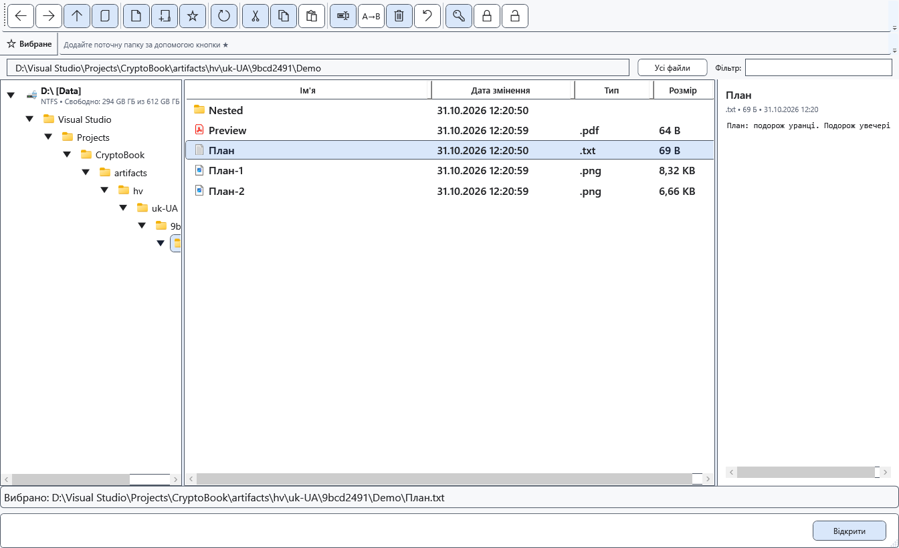
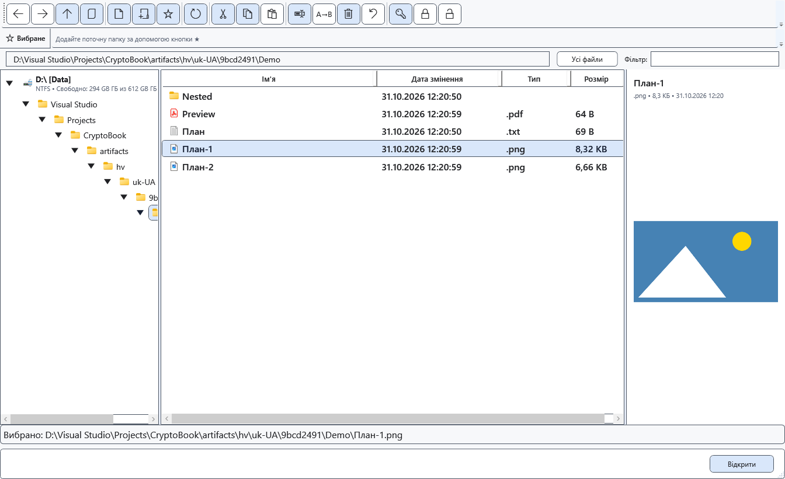

# Попередній перегляд у файловому менеджері

Права панель файлового менеджера дає змогу прочитати текст або переглянути зображення без відкриття окремого редактора.

## Перед початком

Виберіть один файл. Для локального захищеного файла потрібен уже введений відповідний ключ. Перегляд Android читає вихідний потік без автоматичного розшифрування.

## Порядок дій

1. Відкрийте файловий менеджер і перейдіть до папки.
2. Виберіть один файл у списку. Перевірте назву, тип, розмір і вміст або повідомлення про обмеження праворуч.
3. Виберіть інший файл, щоб змінити перегляд. Для редагування або повного перегляду відкрийте файл відповідною командою.

## Перевірка результату

Текст підтримується для TXT, LOG, MD, CS, XAML, JSON, XML, YAML/YML, INI, CONFIG, CSV та TSV; читаються перші 512 КіБ. Зображення PNG, JPG/JPEG, BMP, GIF і WEBP обмежено 32 МіБ; декодування залежить від Windows. Це не повний перегляд RTF або PDF.

## Скасування й повернення

Виберіть папку, інший файл або закрийте вікно. Перегляд не записує змін у файл.

## Якщо не вдалося

Завеликий файл, непідтримуваний формат, хибний ключ або відключений пристрій дають повідомлення замість вмісту. Локальний захищений перегляд обмежено 32 МіБ і підтримуваним вмістом. Віддалений захищений файл спершу явно розшифруйте або скопіюйте локально.

## Пов’язані теми

- [Навігація папками](help:files.navigate)
- [Можливості й обмеження пристроїв](help:devices.limits)
- [Перегляд зображень у медіаплеєрі](help:view.images)
