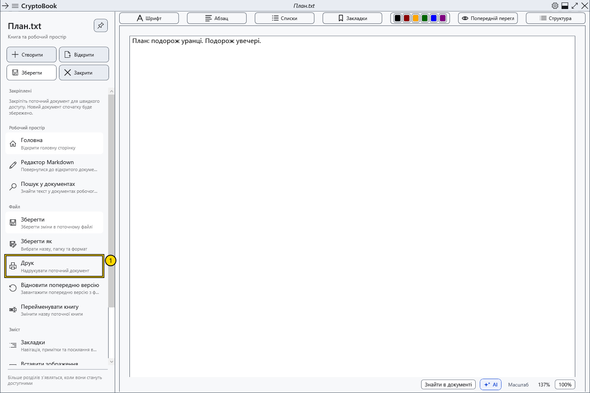

# Друк поточного документа

Друк передає поточний документ системному діалогу. Звичайний документ зберігає оформлення; Markdown спершу перетворюється на відображений документ.

## Перед початком

Активуйте потрібний звичайний документ або Markdown із непорожнім друкованим вмістом. Перевірте принтер, папір і доступність пристрою. Друк може розкрити захищений вміст на папері або у вихідному файлі.

## Порядок дій

1. У бічному меню виберіть **Файл → Друк**.
2. У діалозі Windows виберіть принтер і доступні параметри. Мова й поля залежать від Windows і драйвера.
3. Перевірте призначення, потім підтвердьте друк або скасуйте системний діалог.

## Перевірка результату

Після підтвердження завдання передається принтеру. Друкована область визначається принтером і може відрізнятися від екрана. Друкується активний документ цілком; виділення тексту саме по собі не обмежує обсяг. PDF друкуйте із зовнішнього переглядача.

## Скасування й повернення

Скасування до підтвердження не надсилає завдання. Після надсилання користуйтеся чергою Windows або панеллю принтера; закриття CryptoBook не гарантує скасування.

## Якщо не вдалося

Команда недоступна — перевірте документ і вміст. Помилка друку — перевірте драйвер, чергу та зв’язок із принтером. Екранний перегляд не підтверджує фізичний друк і точний вигляд на папері.

## Пов’язані теми

- [Параметри й колір сторінки](help:edit.page)
- [Перегляд, сторінки й масштаб](help:edit.view)
