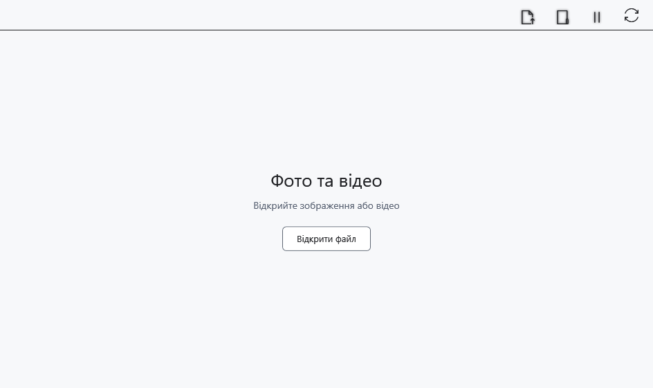

# Відео й кілька вікон плеєра

Медіаплеєр відкриває відео в окремому вікні. Підтримка залежить від контейнера, кодека та доступного декодування; саме розширення не гарантує відтворення.

## Перед початком

Використовуйте локальне відео або локальну копію з пристрою. Вікно доступне через **Зміст → Фото та відео** і кнопку початкової сторінки.

## Порядок дій

1. Натисніть **Відкрити в цьому програвачі** і виберіть відео. **Відкрити в новому програвачі** відкриває вибраний файл в іншому вікні.
2. В області відео використовуйте елементи Flyleaf: відтворення/пауза, часову шкалу та звук. Наведіть вказівник, якщо панель прихована.
3. За фокуса в області відео ←/→ перемотують; Alt+←/→ переходять до попереднього/наступного відео каталогу, якщо воно є.
4. **Призупинити всі програвачі** призупиняє плеєри. **Синхронізувати відтворення (експериментально)** вмикає експериментальний зв’язок вікон; вимкніть його для незалежного керування.

## Перевірка результату

При успішному відкритті видно кадри й рухається позиція відтворення. Перехід до сусіднього відео використовує вибраний каталог, а не всі відео комп’ютера. Синхронізація не обіцяє точного покадрового збігу.

## Скасування й повернення

Призупиніть, відкрийте інший файл або закрийте вікно. Закриття не видаляє відео. Вимкнення синхронізації повертає незалежне керування.

## Якщо не вдалося

Немає кадру чи є помилка — перевірте локальну копію, цілісність файла та підтримку кодека. Дія клавіш залежить від фокуса; сполучення редактора не поширюються автоматично на Flyleaf. Його шкала й додаткові команди можуть мати власне оформлення.

## Пов’язані теми

- [Перегляд зображень у медіаплеєрі](help:view.images)
- [Можливості й обмеження пристроїв](help:devices.limits)
